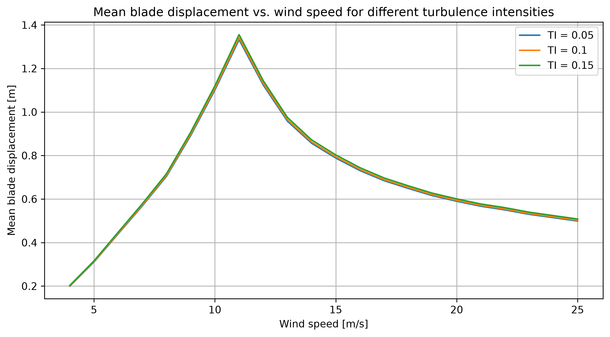
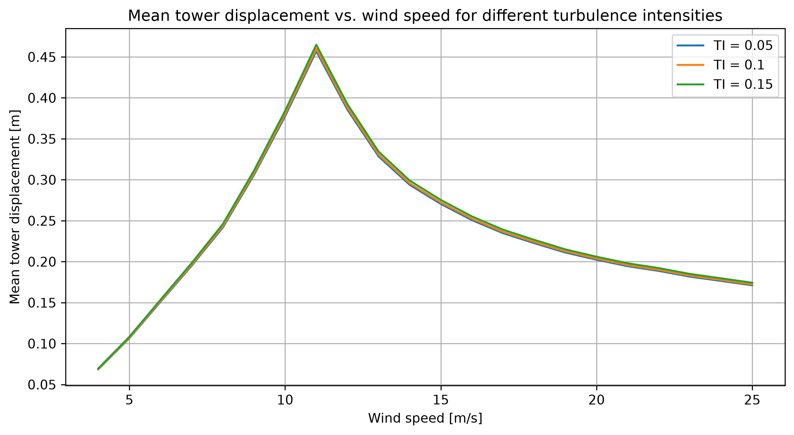
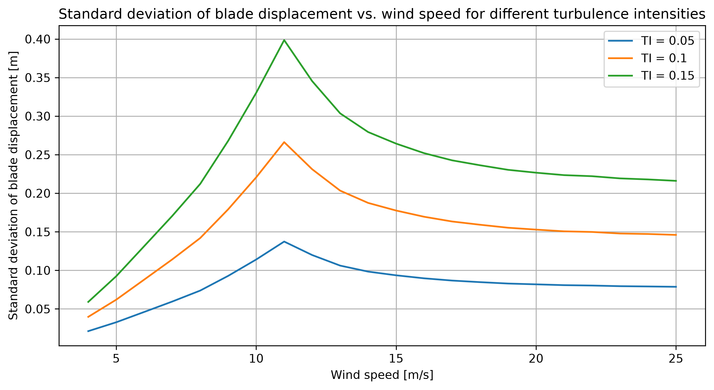
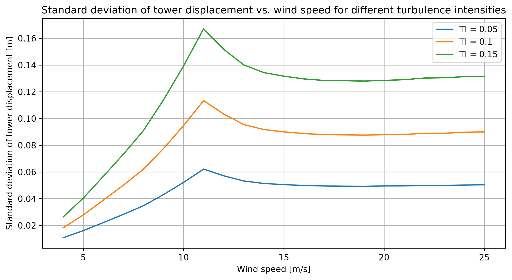
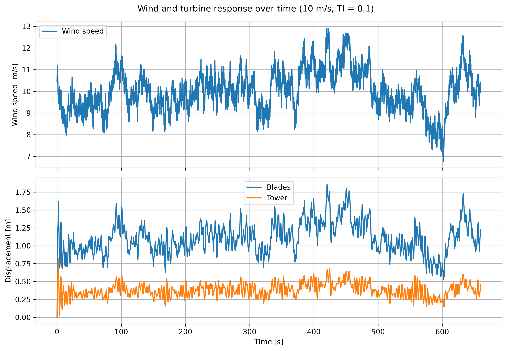

# Project 2 - Turbie

This program simulates the blade and tower movements of the simplified Turbie wind turbine model. It runs 66 simulations: wind speeds from 4 to 25 m/s at turbulence intensities of 0.05, 0.10 and 0.15.

The functions are stored in turbie_mod.py, while main.py runs the simulations and saves the results. The equations are solved using scipy.integrate.solve_ivp, starting with zero displacement and velocity.

The thrust coefficient CT is found by interpolation using the mean wind speed of each input file. It stays constant during that simulation. The rotor diameter is taken from the supplied parameter file, which gives 178 m rather than the 180 m stated in the assignment.

## Results and discussion

The mean displacements increase up to 11 m/s and then decrease. At 11 m/s, the mean blade displacement is approximately 1.33–1.36 m, while the tower displacement is approximately 0.46 m.

The decrease at higher wind speeds is explained by the CT values in the supplied table. CT decreases enough to outweigh the increase in wind speed squared, so the mean aerodynamic force decreases.

Changing TI has only a small effect on the mean displacements. The three curves are close together, although higher TI gives slightly larger values.

TI has a much clearer effect on the standard deviations. Higher TI gives larger wind speed fluctuations, which cause greater variations in aerodynamic force and displacement.

The standard deviations also peak around 11 m/s. Above this, the blade standard deviation decreases, while the tower standard deviation levels out and rises slightly towards 25 m/s.

The blade displacement is larger than the tower displacement. Though they´re measured in a global coordinate system, just like the 2DOF mass-spring-damper-system, so the blade displacement includes the tower movement and is not blade bending flapwise alone.

This example shows the response at 10 m/s and TI = 0.10. Both displacements broadly follow the changes in wind speed.

The initial oscillations occur because the wind load acts on a system starting from zero displacement and velocity. These oscillations are included in the calculated means and standard deviations.

## Running the code

The program requires Python with NumPy, SciPy and Matplotlib.

Run `python main.py` from the project directory.

Input files are stored in inputs. The program saves 22 simulation files and one statistics file in each TI folder under outputs. The five figures are also saved in outputs.

The figure windows appear during execution. Close each window to let the program continue.